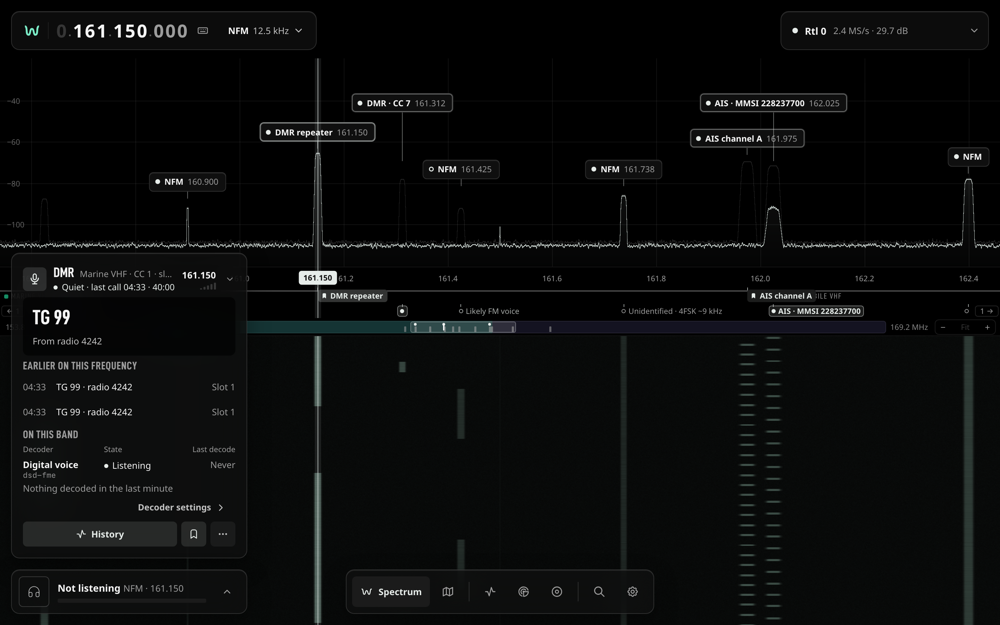
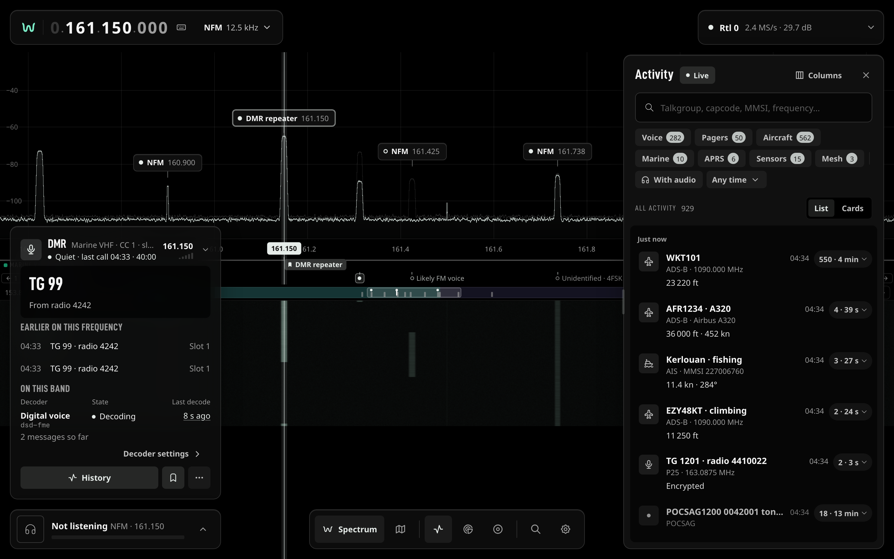
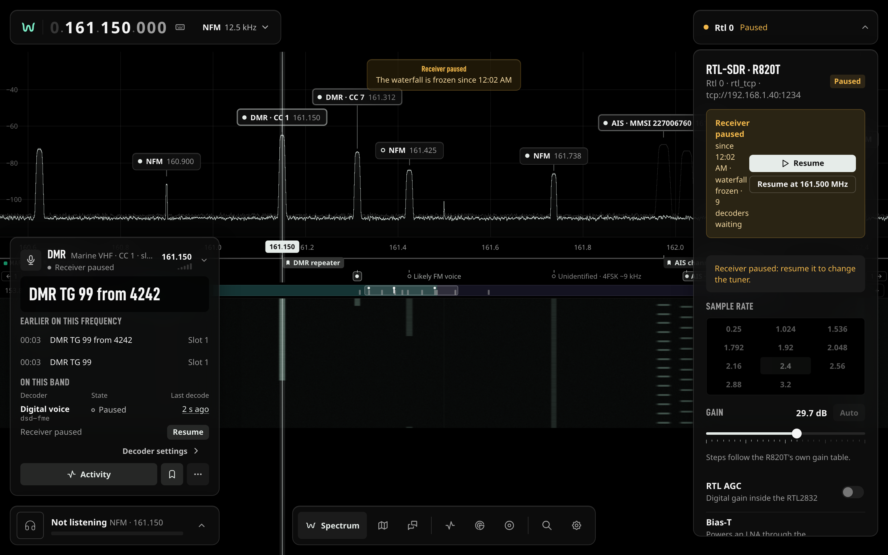
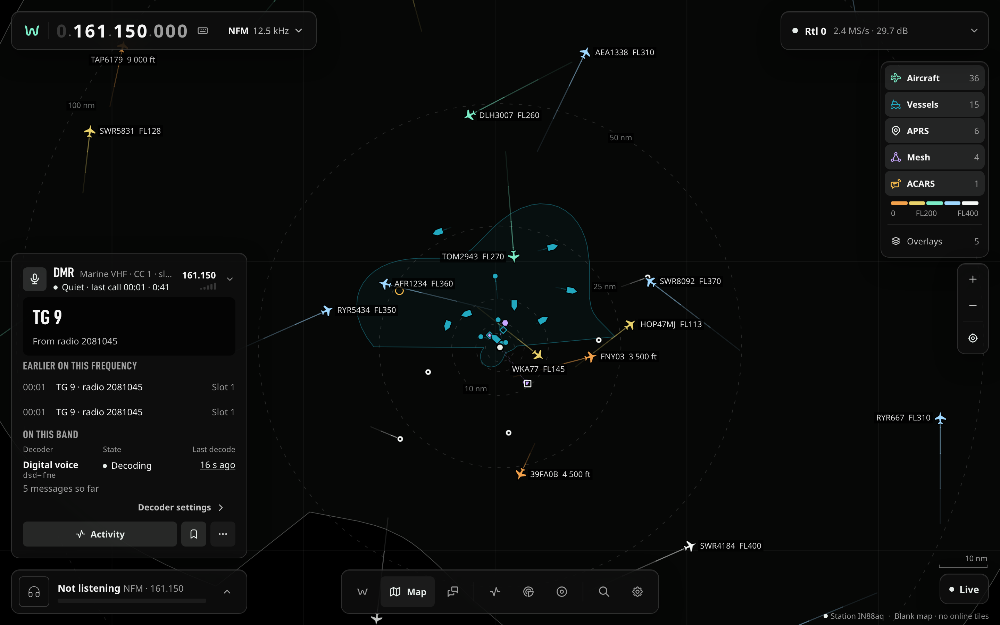

# Using the web app

The web app is WaveKit's main interface. It runs in any recent browser, on a desktop or a phone,
and talks to the core over its REST API and WebSocket. The code lives in [`web/`](../web/).

## Open it

- **Without a radio:** `pnpm --filter @wavekit/web mock`, then `pnpm --filter @wavekit/web dev`,
  and open <http://localhost:5173>. The mock plays a station with aircraft, ships, pagers, DMR and
  more ([`web/mock/README.md`](../web/mock/README.md)).
- **With your core:** `WAVEKIT_WEB_API=http://<core-host>:9000 pnpm --filter @wavekit/web dev`.
  When the core runs on another machine, set its `liveDemod.publicOrigin`
  (`WAVEKIT_LIVE_DEMOD__PUBLIC_ORIGIN`) so live audio reaches your browser
  ([core reference](CORE-REFERENCE.md)).
- **Protected core:** the first visit shows a **Pair this browser** chip. Pair once, and the
  browser stays signed in. Signed-in devices are listed in the ⌘K palette. A session lasts 30 days
  from its last refresh: the app refreshes it when it opens and when its window comes back to the
  front, once less than 29 days are left (at most once an hour), so a browser used at least once a
  month never has to pair again. A browser whose session ran out (or was signed out from another
  device) shows **Session expired, pair again** instead of the bare pairing prompt.
- **One address:** a protected core accepts the address named in its access settings and no
  other. `localhost` and `127.0.0.1` reach the same server, but to the browser and to the core they
  are two sites, each with its own sign-in. Opened under the one the core refuses, the app shows
  **This address is not accepted · Open 127.0.0.1:5173 instead**; the chip is a link to the same
  page on the other name. When that one is refused too, or off this machine, it reads **Allow it
  in the core's access settings**
  (`access.allowedAuthorities` and `access.allowedOrigins`, [Docker setup](DOCKER-SETUP.md)).
  The dev and preview servers do the first step for you: a page opened under a loopback name the
  core refuses is sent to the loopback name it accepts. Only `localhost`, `127.0.0.1` and `[::1]`
  are ever tried, and the core still decides which one it accepts.
- **Opened before the core:** a page opened while the core is down or restarting shows **Can't
  reach the receiver · Retrying…** and loads by itself once the core answers.

## The screen

The app has two views, picked from the dock at the bottom: **Spectrum** and **Map**. Drawers open
on the right on top of the view: **Activity**, **Scanner**, **Recordings** and **Settings**.
Decoded messages as cards live in Activity's **Cards** layout (the Messages view is gone; see
[Drawers](#drawers)). On a phone, the ⌘K palette (the search button) is the way around.
Beside a full-height drawer, notices and the spectrum's status notes (`No source connected` and
the like) centre on the free area left of it, never under the drawer.

### Notices

Notices appear at the top centre of the spectrum, just under the Tuner and Receiver (and under the
connection chip when it sits there). There are two kinds, and at most one of each shows at once:

- **What you just did**, such as `Saved`, `Copied` or `Removed`, often with **Undo**. It stays
  6 seconds; the next one replaces it.
- **Something that is going on**, such as lost samples or an update waiting. It shows for
  8 seconds, then stays visible in its usual place: lost samples on the Receiver island
  (`Samples lost` with a warning triangle, and the full sentence in the Receiver panel). Neither
  kind removes the other, so an Undo is never pushed away by a warning.

**WaveKit was updated · Reload** stays until you reload or close it. Notices wait while the ⌘K
palette is open and while the pointer or keyboard focus is on them. ✕ closes one.

When WaveKit loses receiver samples, the notice says why:

| Cause                                                  | Notice                                                          |
| ------------------------------------------------------ | --------------------------------------------------------------- |
| The link from the receiver cannot carry the rate       | `Receiver link dropping samples — lower the sample rate`        |
| The same, while the 1090 MHz rate policy holds a raise | `Receiver link dropping samples at 2.4 MS/s (raised for ADS-B)` |
| WaveKit itself was too busy to read the samples        | `Samples lost: WaveKit is too busy to keep up`                  |
| WaveKit cannot tell which                              | `Receiver samples lost`                                         |

Only the first asks for a lower sample rate. The notice comes once the loss has lasted 6 seconds,
and once per episode: an episode starts with the first loss and lasts until the link has been clean
for a minute, so a link that recovers and drops again does not repeat it. A different cause in the
same episode shows once more, except a change to an unknown cause. After ✕ nothing more shows in
that episode; the Receiver island still says `Samples lost` while samples are being lost. A page
reloaded during an episode shows it on the Receiver island only. If the app stops hearing from
WaveKit for 10 seconds, the notice goes and the Receiver island's marker turns grey until fresh
news arrives. Samples dropped inside WaveKit after they all arrived, or a link that has not yet
shown it can carry the rate, raise nothing. While the Receiver panel is open, it lists these instead
of a notice, and a notice held back that way counts as shown: closing the panel does not bring it
up. A notice waiting behind **WaveKit was updated** counts only once it shows. A sample-rate raise or restore by the rate policy is a short notice of its own; a raise
it had to skip (another client has the tuner, or the receiver refused the rate) stays listed in the
Receiver panel for 5 minutes.

### Spectrum and waterfall

- Drag the spectrum to tune, or click a peak. Drag past the edge of the capture to retune the
  receiver.
- The band ruler under the spectrum shows the band plan and your saved frequencies. Zoom with its
  `−` `+` buttons.
- Labels on the peaks say what WaveKit identified there (`DMR · CC 1`, `AIS · MMSI …`). Settings ›
  Spectrum › Signal labels chooses how many you see.
- Labels and tags always sit at their own frequency inside the visible span. After a retune or a
  sample-rate change, the labels from the previous window disappear at once; only signals heard in
  the new window are labelled.
- The spectrum stream recovers by itself, a core restart included. If the connection to the core
  drops, or the stream goes silent, the plot reads `Spectrum stream lost · reconnecting…` and
  retries with growing pauses (up to 10 s) until frames come back. While the receiver is paused it
  stays connected and checks every 30 s, so the waterfall comes back after a resume even when this
  page missed it (another browser resumed, or the page's connection dropped meanwhile); a resume,
  a retune, a sample-rate change or returning to the tab checks at once. If the page cannot reach
  the stream from the start, it reads `Spectrum stream not reachable · retrying…`. When the core
  says this browser is no longer signed in, it stops and says so: pair the browser again and the
  spectrum comes back, with no reload.
- While the spectrum starts the plot reads `Starting the spectrum…`. On a busy machine the
  renderer can take seconds to come up; the stream is subscribed meanwhile, and the rows received
  in between are drawn as soon as it is ready.
- The spectrum is drawn with WebGL2. A browser that has none (graphics acceleration turned off
  or blocked; Chrome turns it off by itself after its GPU process crashed a few times) still draws
  the trace and the waterfall, with a plain 2D canvas, and shows the chip **Graphics acceleration
  is off · basic mode** on the frequency axis. In Chrome, `chrome://gpu` says why; restarting the
  browser usually turns it back on. When you return to the tab the plot asks for WebGL2 again and
  goes back to it by itself (after a try that ended in basic mode again it waits 30 s, then twice
  as long each time, up to 10 minutes). If the graphics context is lost while drawing, the plot says so and draws again when
  the browser restores it.
- For a plot that stays empty, the browser console answers `window.__wavekit.spectrumHealth()`:
  what draws (`rendererKind`: `webgl2`, `canvas2d` or `none`, with the `reason`), where
  (`rendererThread`), `framesReceived`, `framesDrawn`, the stream's `link` and the `lastError`.
- With **Spectrum range: Fixed**, a scale the signal has left (another receiver, antenna or gain
  moves the noise floor by tens of dB) would draw an empty plot. The plot then reads `The noise
floor is below the fixed scale` (or `above`), with a **Use Auto range** button.
- Right-click a signal for its menu, which includes **Decode as…** to try a decoder on it.
- Signals close together share one tag with a count (`DMR · CC 1 +2`). Click it for a list of the
  grouped signals; each row has a **Tune** button.
- When found signals lie outside the visible span, a marker at that edge shows how many, with an
  arrow (its tooltip reads `3 signals outside view →`). Clicking it asks "Tune to … MHz?" for the
  nearest of them first; it never retunes on its own.
- Click a tag to see what it is (see [Spectrum tags](#spectrum-tags)). A group lists each signal
  with its state, the protocol (`DMR` once verified; before that `Likely DMR`, `Maybe DMR` or
  `Heard`), a muted `likely <kind>` hint (for example `likely ISM device`) when nothing has been
  verified yet, the next step from the decoders that cover its frequency (for example "Listen to
  check", "Widen the capture so … fits" or "No decoder covers this frequency; run identify") and a
  **Tune** button. Clicking a tag never tunes by itself. The same `likely …` hint and next step
  appear beside unverified rows in the Scanner lists.

#### Spectrum tags

There are two kinds of label on the spectrum. The labels over the peaks follow what is on the air
now (a proven one waits between bursts, see below). The tags in the row under the band ruler are the scanner's **discoveries**: frequencies it
has heard and kept, with what it has learnt about each.

A tag is in one of three states:

- **Heard**: something transmits there and nothing has identified it. The tag stays grey and says
  what was measured, for example `Unidentified · 4FSK ~9 kHz`.
- **Likely**: the signal's shape suggests a protocol (`Likely DMR`, `Maybe FM voice`), but no
  decoder has checked it.
- **Proven**: a decoder checked it (`DMR · CC 1`), or an analog proof such as a CTCSS tone. The dot
  is filled and the tag has an outline while it is live.

A tag is bright while its discovery is live. A proven tag stays lit for 5 minutes after it was last
heard, and any other tag for 90 seconds, so a signal that only sends short bursts (a DMR control
channel, a pager) does not flash with every burst. A continuous carrier is on the air all the
time, so its tag never goes away. If nothing identifies it, it stays quiet and grey.

The labels over the peaks use the same evidence:

- A label on a proven discovery has a filled dot and an outline, like its tag. While that tag is
  lit, the label stays between bursts, so a DMR control channel shows one steady `DMR · CC 1`
  instead of flashing. Once the tag dims, the label goes the next time the signal is quiet.
- A label names a protocol only when its discovery is proven. A discovery marked decoded whose
  evidence says weak (or whose proof does not prove it) is not proven, so its label reads
  `Unidentified · …` instead of `DMR`.
- An unnamed peak near a likely discovery reads as its tag does, for example `Likely DMR`. Near
  a discovery that was only heard it says what was measured, for example
  `Unidentified · 4FSK ~9 kHz` with its frequency, and has a grey ring for a dot. Any other
  unnamed peak shows its frequency.
- A held proven label moves to a new burst only when that burst is the same signal: its centre
  within a quarter of the label's width (or the spectrum's resolution, if wider) and its width at
  most 1.5 times the label's or the other way round. A narrower neighbour one channel away gets
  its own label.
- Any other label stays a few seconds after its signal goes quiet, as before.
- Hover over a label that sits on a discovery to see how we know (the tag's first detail line).
  Clicking a label tunes there. For the full detail, click the tag in the row below.

Click a single tag for its detail:

- **How we know**: for example `DMR decoded: checked control bursts, colour code 7`, or
  `Not proven: heard on the air, not identified`. The core's own proof summary shows as a
  `Core:` line only when it says something the line above does not.
- **live** after the frequency means it was heard in the last 30 seconds. The tag itself stays
  lit longer (see above).
- **Evidence** (`Proven`, `Weak`, or `Not reported` by an older core), **First heard**, **Last
  heard** and **Airtime**.
- **Calls**: the scanner checks a channel by decoding it for a moment. When that check saw calls,
  the detail names them, for example `Talkgroup 1, source 12 seen by the scanner's check` (at most
  three of each, then `+n more`). Calls the scanner's check decoded are not Activity rows: Activity
  lists what the decoders heard, so it may have nothing on that frequency yet, and the detail says
  so. A proven digital voice channel with no call in it says `No calls heard yet — control
channel only`. **History of …** (`History of Club net`, `History of 145.6125`: the channel's
  name, else its frequency) opens Activity on the channel: its raster frequency, half a raster
  step either side, never the signal's measured width. **Open last transmission** shows only when
  the core names the discovery's last Activity event, and opens it.
- **Tune** and **Listen** go to the discovery's measured frequency, as the Scanner drawer does.
  **Listen** is the drawer's Listen: it tunes there, then starts live audio once the tune has
  landed. If the tune fails, nothing plays and a `Could not tune: …` warning says why. If the
  receiver is tuned elsewhere meanwhile, nothing plays here. The core's live audio is left
  running, because other browsers may be listening to it. Turning Listen off stops the core's
  live audio only when a fresh status shows no other listener on either stream.
  **Evidence** opens the discovery in the Scanner drawer.

#### One name per channel

A channel reads the same everywhere (tags, the tuned card, Activity rows, Recordings, the
palette): your saved name first, then the operator's label, the proven protocol (`POCSAG pager`,
`FM voice`), the likely one (`Likely DMR`), then what was measured (`Unidentified · FM ~25 kHz`).
A saved frequency names the channel within half a raster step of it, so a carrier measured a
little off the raster still gets its name, and a neighbouring channel never does. NFM is only the
demodulator setting: what was heard on an analog channel reads `FM voice`. Every door that opens
a channel's history (the tag detail, the tuned card, the palette, Recordings) opens the same
Activity window, and its search chip states the width, for example `Club net · 145.6125 ±6.25 kHz`.

### The tuned card

The card on the left follows the frequency you are tuned to. From the top it says what the signal
is, then the frequency once, the mode and channel width, the decoders on its band, and the actions
(Activity, save, Identify, Open message).

The header names the signal from the most specific thing known: the protocol last heard, what
Identify or a proven discovery named, the decoder whose band holds the frequency, then the band
plan's band. A decoder that is off names it only where the band plan has no band there, and says
so ("Pager (off)"). A decoder whose channel only follows the tuner (the pager decoder listening to the
live audio, say) never names a frequency outside its band, and the card never says "Nothing decodes
this frequency" while a decoder's band holds it. The protocol last heard and the **Latest** line
leave out decodes from a decoder whose band does not hold the frequency, as the core reports it: an
old false pager decode stored at 1090 MHz never makes the ADS-B card read POCSAG. A decode from a
decoder with no band to read (none from the core, its status or the band plan) still counts, as do
Identify's own probes. A decoder forced on outside the band plan never names the card: its band
is not readable there, by the same rule the core applies. "Decoded here by" names only a decoder on the tuned
channel itself, one of its fixed frequencies within the channel (ADS-B anywhere readsb covers, its
signal fills 1089 to 1091 MHz). A decoder whose band merely spans the frequency, such as the ISM
decoder at 434.000 MHz with its channel at 433.920 MHz, reads "ISM decodes this band, not this
channel", and **Identify on its own** still identifies a transmission there. Elsewhere in the ADS-B
band, past readsb's 200 kHz reach, the card gives the band plan's reason: "Decoded elsewhere ·
readsb". On a data band (the band plan's mode is RAW, such
as ADS-B at 1090 MHz) or with the receiver set to RAW, the card shows **No audio (data band)**
instead of the demodulator and "Quiet".

**On this band** is a table of the decoders whose band holds the frequency (within 200 kHz of one
of their frequencies or of the span between neighbouring channels of one cluster, or inside their
band). Frequencies more than 2.4 MHz apart are separate bands, a fixed gap whatever the receiver's
sample rate: LoRa, which listens at 433 and 869 MHz in Europe, is not listed at 446 MHz. A decoder
that follows the receiver centre (`followCenter`) holds the whole band between its declared edges,
so LoRa following 902–928 MHz is listed at 915 MHz. The core decides which
those are: the card asks `GET /api/decoders/summary?hz=<Hz>` and lists the items with
`coversHz: true`, so an agent using the same endpoint sees the same list. Right after the core
starts, before the receiver reports its capabilities, a decoder's configured frequencies stand in
for its band, so ADS-B shows at 1090 MHz from the first moment. If that request fails (the core
answers an error, the request times out or the network drops), the card lists the decoders from
their statuses instead of waiting, and takes the core's answer again once a request succeeds. It
picks them by the core's own rule: the decoder's band, else its configured frequencies (never one that
only follows the tuner, so the pager is not listed at 1090 MHz because its channel sits there), else, for a
decoder with no band of its own such as the pager or digital voice, the receiver's band plan ranges
that list its protocols (POCSAG, DMR). When Settings turns a decoder off or it is stopped, its row
says so at once, before the core's next answer arrives. Each decoder takes two compact lines, set
apart by space rather than divider lines:

| Column      | Shows                                                                                                                                                    |
| ----------- | -------------------------------------------------------------------------------------------------------------------------------------------------------- |
| Decoder     | Its name and program, for example ADS-B over `readsb`                                                                                                    |
| State       | A dot and one word: Decoding, Listening, Starting, Waiting, Paused, Failed or Off (filled dot while it runs)                                             |
| Last decode | How long ago it last decoded; opens Activity on that decoder's events only. "Never" when it has not                                                      |
| Detail      | The second line: the reason from the core's verdict ("CPU budget full"), or how much it decoded, full width                                              |
| Action      | At most one small button, at the right of the detail line, only when the verdict suggests one the card can carry out; the detail never repeats its label |

Decoders that decode come first, then those starting, failed, paused, waiting and off. In a narrow
drawer or on a phone each decoder stacks: name, state and last decode, then the detail and its
button. One **Decoder settings** link at the foot opens Settings › Decoders (at a decoder that is
off, if there is one); rows never link to Settings.

| Suggestion                               | Button                                 | What it does                                                                                                              |
| ---------------------------------------- | -------------------------------------- | ------------------------------------------------------------------------------------------------------------------------- |
| Start (a stopped decoder)                | Start                                  | Starts that decoder                                                                                                       |
| Restart (a failed decoder)               | Restart                                | Restarts that decoder                                                                                                     |
| Raise the CPU budget                     | Raise CPU budget                       | Adds one core to the decoder CPU budget, up to its maximum of 64 (Undo in the toast); Settings › Decoders keeps the value |
| Pause the scanner                        | Stop the scan                          | Ends the scan, which gives the tuner and the decoders back (a paused scan keeps them)                                     |
| Resume the receiver                      | Resume                                 | Resumes the paused receiver feed, as the Receiver's Resume does                                                           |
| Tune to its band                         | Tune to 1090.000                       | Tunes the receiver to the decoder's frequency                                                                             |
| Change the sample rate, check the source | Raise sample rate, Check the receiver… | Opens the Receiver, where you set it                                                                                      |

A decoder that is starting or waiting never offers Restart, and a failed decoder the core is
already restarting on its own reads "Restarting on its own" without a button. Suggestions that
belong in Settings (turn on, turn off others, install, channelizer) are left to the foot's link. When
the budget is already at its maximum, the next suggestion's button shows instead of Raise CPU
budget; the card reads the budget again each time it refreshes the verdicts, so a budget lowered
elsewhere offers the raise again. The raise and its Undo each change the budget only if nobody
changed it since the card read it (the core checks this as it saves); otherwise the toast says so,
names the value now set, and leaves it. Stop the scan shows while a scan holds the decoders: moving,
holding on a hit, or paused. A verdict this app does not know shows as plain text without a button.
With read-only access the buttons that change something are disabled; the links still work. A core
without `coversHz` is read from the decoders' own bands instead.

### Listen

The bar under the tuned card plays the demodulated audio in the browser: analog modes with squelch
and tone squelch, and decoded digital voice. **Record** saves a WAV file from the browser.

The bar's title says what you hear, in one line:

- **Quiet**: nothing passes the squelch (or a tone squelch waits for its tone, or Source is Digital
  and no decoded call is playing, between calls or with no decoder on the channel).
- **Waiting for voice**, with **Play anyway**: a carrier is up and Voice only holds it until someone
  talks. **Play anyway** turns Voice only off so every carrier plays; the toast has **Undo**, which
  turns Voice only back on unless the squelch was changed again since.
- **Listening**: audio is playing. A decoded call says so under it, for example `DMR voice · TG …`.
- **Open**: the squelch is open, and it stays open across retunes until you change it.

A decoded call the core does not play is named under the title whatever it says (unless Source is
Analog or the squelch is Open): `DMR voice · checking…` while the core does not know yet whether the
call is encrypted (it is never played or shown as clear until that is known), and
`DMR call is encrypted: nothing to play.` for an encrypted one (`DMR call is encrypted: decoded voice
is not played.` while the squelch passes the analog channel and the title says **Listening**). **Play anyway** is not offered then:
it would only play the call's digital noise. The line under **Source** says the same.

**Audio options** sets the squelch in one row, **Auto | Manual | Open**:

- **Auto** opens on a carrier above the noise floor and follows conditions. On NFM, the **Voice only**
  switch under it (on by default) waits for evidence that someone is talking, voice or a CTCSS or DCS
  tone: "Skips carriers, data and pagers. Voice starts about 1 s late, nothing is cut." The squelch tag
  says what let the audio through, for example **CTCSS heard**, and reads **Quiet** whenever the title
  does (Source Digital between calls, for example).
- **Manual** is the line on the level bar: everything above it plays. Dragging the line selects Manual
  at once; the spectrum shows the same dashed line, in Manual only. Choosing Manual from Auto starts the
  line where Auto had it.
- **Open** plays everything, noise, pagers and data included. Transmissions are still detected and
  logged in Activity at the Auto threshold. `Q` opens the squelch and goes back to the squelch before it
  (a tone-only squelch comes back exactly as it was); from the defaults, `Q` alone, or **Audio options**
  then **Open**, plays the noise. Opening from `Q`, the panel's **Open**, the palette's **Squelch ›
  Open** or a typed `sq open` / `sq off` also starts Listen in this browser once the core has taken the
  change. **Settings › Audio › Squelch › Open** only changes the setting, without starting Listen; `Q`
  still goes back from it to the squelch before.

**Source**, **Auto | Analog | Digital**, says what Listen plays. **Auto** plays the analog audio or a
clear decoded call, decided per transmission; **Analog** only the demodulated audio; **Digital** only
decoded voice, silence otherwise. With no digital voice decoder on the channel, Digital plays nothing
and the panel says so, with **Use Auto**. Open always plays the analog audio.

The squelch, Voice only and Source are settings of the core: every browser and client listening sees
the same ones, and a change applies at once without restarting the audio stream. Volume stays in this
browser. The per-browser "What you hear" choice of earlier versions is dropped (removed from this
browser, never sent to the core), so Source starts at what the core has. A core older than these
settings offers Auto, Manual and Open only (Open is sent as a manual squelch of 0) and picks the source
itself. The `autoSquelch` and `autoRoute` fields of
[`GET /api/live-audio/status`](API.md#get-apilive-audiostatus) report the voice check and what plays.

**Connecting…** means Listen is starting, no audio has played for about 2 s, or the stream ended and is
being reattached. If no data at all arrives for 5 s, Listen reattaches by itself; after about 28 s of
failed attempts it shows **No audio** with the reason, and stays there while it keeps trying, until
audio returns.

A short gap on an open stream keeps **Listening**. When over 10% of the audio you should be hearing
did not play in the last 10 s, the card says so next to it, for example
**Listening** `Breaking up · 71% heard`, until the figure is back within 5%. It needs at least 5 s of open
signal to judge, and silence from a closed squelch never counts. **Audio options** gives the figure and
the total missing since Listen started, next to the latency, for example `71% heard · 17.4 s missing`;
hover it for what the core reported. The web app reads the core's figure every 2 s, so it can lag a little;
a reading that fails is made up by the next one. After 10 s of playback with no reading it only knows what
this browser played: it gives a percentage only if that alone is breaking up, and a card already breaking up
stays that way, without a percentage if it has none, until a reading arrives.
Time this browser was not playing the stream (a suspended tab's audio, a reattach, another stream) never
counts as missing.
The latency includes audio waiting in the core.

Breaking up usually means the core is too busy. It catches up a late stream by up to 500 ms at once, which
hides short stalls, but it cannot recover audio it never received: when the receiver's data backs up inside
the core (`Branch congested` in its log), the holes stay until the load comes down. The `<audio>` fallback, used where the browser lacks Web Audio, reattaches the same way but shows no figure.

## Drawers

- **Activity:** everything WaveKit heard, newest first. Search by talkgroup, capcode, MMSI, ICAO,
  callsign or frequency, filter by category and time range, show a list or cards, choose columns.
  **Cards** shows each event as its decoded message card; **Expand** beside it widens the drawer
  across the window between the islands and lays the cards out in as many columns as fit (340 px
  each, up to three), for reading pages and packets side by side; **Collapse** brings it back.
  This replaces the old Messages view: `#/messages`, a link with `view=messages` and the ⌘K
  **Messages** row (`G` `D`) open Activity in Cards. A scanner recording's row is a transmission:
  it reads `FM voice` (or the channel's saved name, with `FM voice` under it), never
  `Recording 145.5625 MHz`.
  **Last decode** on the tuned card opens it on one decoder: a **Decoder ADS-B** chip in the
  search lists only that decoder's events; remove the chip with its `×` like any other filter.
  If the core rate-limits a request, Activity retries by itself up to 3 times, unless the core asks
  for a wait over 10 s. Each wait is the one the core asked for (at least 0.25 s; 0.5, 1, then 2 s
  when it names none) plus up to 20 % random jitter, so a single wait can reach 12 s. If retrying
  stops, Activity shows `rate limited, retry in N s` (or `rate limited, retry later`).
  While the core is still opening its Activity store, the drawer says `Activity is starting…`; if
  an open failed and the core is retrying, it says `Activity store unavailable, retrying`. It checks
  again every 3 s and loads the list by itself once the store opens.
  The counts on the category filters follow new rows every 4 s while the list is live. When the
  core is slow to count (a large store on a busy host) they refresh less often, at most once a
  minute: 50 times the last count's duration, and doubling after each failed count. Changing the
  search, a filter or the range recounts at once.
  Opening the drawer reads the list first, then the filter counts, then each pinned column in
  turn after the list is on screen, never more than two reads at once. A list read that takes
  over 3 s says `Still loading. WaveKit is busy.`; one with no answer after 10 s, or a failed
  one, says what failed with **Try again**, and the list tries again on its own after 2, 4, 8, 16
  then every 30 s.
  Repeats fold into one row per thing going on (see [Activity folding](#activity-folding)).
  The count beside the list title is the number of events the core counts for the search, the
  same unit as the category filters (not the folded rows on screen). A pinned column shown in its
  place, or a core that cannot count, shows the loaded events instead, with `+` while older ones
  are not loaded. **With audio** keeps only the events that have a recording to play, in every
  category. A row or card with a recording has a play disc with its length; see
  [Playing recordings](#playing-recordings).
- **Scanner:** watch the band in view or plan a scan, see the signals found, skip the ones you do
  not care about, save presets. A row the core suspects is a receiver spur says so on its second
  line: `Receiver spur` once confirmed, `Possible spur (unverified)` while the suspicion is not yet
  confirmed (for example just after a restart).
- **Recordings:** recordings kept by the core, to play, search and keep, including one scanner
  recording per analog voice transmission the scanner finds. Every recording the core holds is
  listed, newest first: the list reads a page at a time as you scroll (up to 10 000 in the
  browser; past that it asks you to search) and keeps only the rows on screen in the page, so it
  stays quick with thousands. The header count comes from the core (`2,350`, or `50,000+` when the
  core left the oldest out), and so does Kept. The search runs on the core: one chip per kind
  (talkgroup, radio, frequency, kind, text; a new chip replaces the one of its kind), and typed
  text matches the talkgroup, radio, decoder, kind, start time or frequency in MHz, never the file
  size or the recording's internal id. A scanner recording is named like its channel (the saved
  name, else `FM voice`), with the frequency in the line under it. Where a file sits in its
  transmission, and why the transmission ended, is said in words, never `Cut`: the parts of a long
  transmission split into files read `Part 1 of 3 · continues` up to the last one, which says how
  it ended (`Part 3 of 3 · Scanner moved on, may be incomplete`, or `Part 5 of 5 · continues` when
  the next file is not listed yet); a single file reads `Scanner moved on at 1:30, may be
  incomplete` (the tuner moved under it while the transmission was on the air, or its tuning stopped
  being trusted; a move that cut off only the silence after it says nothing), `Continues…` while the
  core has not yet linked a rolled-over file to its next part, `Receiver lost` or `WaveKit stopped`
  (separate overs of one held carrier get no part number). An open row has the same actions in the
  same order everywhere: **Play**, **Keep** (**Kept**, click again to unkeep; `S`), **⋯** (Download,
  Tune, Evidence, Delete with Undo) and one channel link, **History of …**, which opens the channel
  in Activity with this transmission open when the core linked it. New recordings
  appear on their own (the core announces each change on the socket; nothing polls); while you
  scroll down or play one from this list, they wait under an `↑ N new` pill. A slow core shows the same states as Activity: nothing for the first second,
  then the placeholder, `Still loading. WaveKit is busy.` after 3 s, and after 10 s (or an error)
  what failed, **Try again**, and a retry on its own after 2, 4, 8, 16 then every 30 s, the last
  rows kept and marked with their time. While the core is still indexing its recordings after a
  start, the list says so and fills in. Closing and opening the drawer again on the same search
  keeps the scroll position. The list is one Tab stop: the row under the cursor; the arrows move
  it and focus follows; Space and Enter on a button inside a row press that button. The footer
  says in words what each recording area holds and what happens at its limit, for example
  `Auto-clean keeps the newest 537 MB of scanner recordings (214 MB used). IQ captures: 96.0 MB of
640 MB (new captures are refused at the limit). Kept items are never removed (12). 41.2 GB free
on disk.`
- **Settings:** station, receiver, decoders (each one starts **auto**, **always** or **off**), band
  plans, spectrum and waterfall, map, units and time, theme, density and motion. **Audio** uses the
  Listen words: **Squelch** (Auto, Manual, Open), **Voice only** under Auto on NFM, **Squelch level**
  in Manual, **Source** (Auto, Analog, Digital), and the Auto squelch margin under **More**. A paused decoder
  says why, for example `Paused · the capture is too narrow here` or `Paused · no channel selected yet`.
  Each decoder lists where it listens and why, for example `162.025 MHz (tuned)`, or
  `(activity)` for a paging or digital-voice channel chosen because it was active.
  **Decoders › Decoder CPU budget** shows the total cores used across sources against the budget,
  with its resolved source (for example `Auto (8 CPUs → 4 cores)` or `configured`). Enter **Auto**
  or a number greater than 0 and up to 64, including fractional cores; press Enter or leave the
  field to save immediately. Invalid values and save errors appear under the row. The control
  is disabled with read-only access or when the core denies settings writes; signing in again
  allows another save attempt. On deployments without settings writes, the row shows the current
  budget and a note to set `decoderPolicy.efficiency.cpuBudgetCores` in YAML config.
  A saved override adds “Saved setting overrides config”. On cores without the budget service,
  the row is disabled and says “Not available”.
  **Receiver › Per-band gain** lists the gain the core sets in each frequency range: scanner hops
  and jobs that tune into a listed band use its gain and give yours back after (also when you
  tune away from a running sweep), so a gain
  that suits one band does not overload the dongle in another (the defaults set 37.2 dB at 868 and
  915 MHz and keep the gain at 2 m, 70 cm and ADS-B). Edit a band's range in MHz and its gain in dB,
  or press **Keep** to leave the gain alone there; **Add band** and the `×` add and remove rows.
  **Save** sends the whole table and **Discard** drops your edits. Fields the core would refuse are
  marked before anything is sent (a range outside 24 to 1900 MHz, an end not above the start,
  ranges that overlap, ends included, a gain outside 0 to 50 dB, more than 32 bands), and the
  core's own message shows under the row if it refuses the save. **Per-band gain for my tuning**
  (off by default) saves at once: on, your own retunes also set the band's gain and give yours
  back outside the bands. See [Per-band gain](API.md#per-band-gain-get-and-put-apituner-band-gain).
- **Receiver › Pause** stops pulling IQ from the receiver without removing it: the core closes the
  receiver connection, the waterfall stops on its last rows under a `Receiver paused` label,
  decoders wait (their status reads paused because the receiver is paused) and the tuner
  controls are locked until you resume. The island shows `Receiver paused · since 14:02 ·
waterfall frozen · 3 decoders waiting` with **Resume**; the island's head reads `Paused`. The
  pause survives a core restart; if the core could not save it, the island warns `Paused, but not
  saved — it will not survive a restart` with **Retry**, which saves it again. **Resume** reconnects once
  and writes the tuning back only when WaveKit is the receiver's only client: the core reads
  rtlmux's client list from the sdr-host, and when a fresh answer lists exactly one client while
  WaveKit is connected (WaveKit itself, whatever port a NAT gives it) and no relay client is
  attached, it writes the centre and rate from before the pause again. Otherwise (two or more
  clients, no answer) it leaves the tuning as found: while WaveKit was paused, SDR++ may have
  retuned the shared dongle through rtlmux, which WaveKit cannot see, so it adopts what it finds:
  until you set them, the island shows the centre and rate as
  `last known … · unverified` (header and Centre row), no sample rate is selected (picking any rate,
  the shown one too, sets it), and gain reads unknown. The tuner state's `resumeOutcome` says which
  happened and why (`port-matched`, `sole-client`, `another-client`, `clients-unknown`,
  `relay-attached`, see [API.md](API.md#post-apisourcesidpause-and-post-apisourcesidresume)).
  While the core cannot prove the tuning (the source's `tuningUnproven`), the island shows the
  core's sentence about it, and recordings and identification of signals wait; **Take the tuning
  back** writes the held centre and rate again in one call
  ([`POST /api/tuner/:sourceId/take-back`](API.md#post-apitunersourceidtake-back)). It is not
  offered while a relay client, a scanner job, external control or another core holds the
  receiver, or while the source is not connected; if the core still refuses, its reason shows
  beside it. When the core measures a common rate from the
  stream it adopts it and the island labels it `measured`. **Resume at 161.500 MHz** (shown when
  the core knows the centre from before the pause) reconnects and writes the centre, rate and gain
  from before the pause back. SDR++ connected through WaveKit's tuner relay is seen: its retunes
  during the pause are written on either resume. If the receiver cannot be reached, the island
  says `Resume failed` with the reason and a **Retry** button, which repeats the same kind of
  resume, and the receiver stays paused. In the ⌘K palette, **Pause receiver** (while live),
  **Resume receiver** (while paused) and **Resume receiver at 161.500 MHz** do the same, and the
  `P` key toggles pause and the plain resume from anywhere; a pause from the palette or the key
  offers Undo. Read-only browsers cannot pause. While paused,
  the tuned card's decoders read Paused, "Receiver paused", each with a **Resume** button; when the
  paused feed holds any decoder on the card's frequency and none of them is decoding (a decoder on
  its own dongle, or on another receiver that is not paused, keeps the header live), the card's
  header reads `Receiver paused` and its summary says the receiver is paused, and
  Settings › Decoders reads `Paused · the receiver is paused`. A scanner identify running when you
  pause ends with what it found so far and reads `Stopped · receiver paused`. A sweep running when
  you pause waits; **Resume at 161.500 MHz** continues it, but a plain **Resume** leaves it held so it
  does not retune the receiver away from SDR++: the scan row reads `Scan paused · receiver resumed
  without retuning` with **Resume scan**, which retunes to the scan's current hop (also **Resume scan**
  in the ⌘K palette). If resuming would interrupt someone (a listener, a decoder started since, another
  scan), the scan row first reads `Resume needs your OK` with a button naming them, such as `Resume and
  interrupt 1 listener, APRS`. A scan that could not resume by itself because of someone new already
  names them on its first button, so one click resumes it. If anyone else has arrived by the time you
  click, nothing is interrupted and the button names them instead. The Resume in the scan plan's footer
  and the Scanner drawer's footer works the same way. A scan that keeps its place by itself has no Resume: `Paused by Marine VHF · carries on
  when it ends` and `Source down · waits for it to return`. A Resume clicked on a paused scan while the source sends no data does nothing and says to try
  again once data returns. In the ⌘K palette, a Resume scan that would interrupt someone asks you to choose Resume in the scan row. The resumed scan hops without a band gain, and when it ends nothing is put
  back: the receiver keeps whatever it was last tuned to. With more than one
  receiver, the Receiver island, the palette's receiver commands (pause, resume, gain, sample rate,
  bias tee, RTL AGC) and `P` act on the receiver the waterfall shows: the first connected one, which
  stays on screen through its own pause (else the first paused one). See
  [pause and resume](API.md#post-apisourcesidpause-and-post-apisourcesidresume).

  

- **Receiver** (the island at the top): under Gain, a quiet line says when the core confirms a
  band gain on the tuner, for example `Band gain 37.2 dB · 868 MHz ISM · while the
scanner tunes` (or `· for your tuning` with the switch on). It shows the gain the tuner really
  has (snapped to its gain step) and goes away as soon as you change the gain, the mode or the
  frequency; turning the switch on shows nothing until your next retune. When the scanner sees broadband
  blanking rise at a manual gain, the line `Front end may be overloaded at this gain (49.6 dB,
7.5 % of frames blanked)` suggests a lower gain; it is a hint, not a measurement.
- When samples are lost on the way from the receiver to WaveKit, the Receiver island says
  `Samples lost` and a notice says why (see [Notices](#notices)).

### Playing recordings

There is one player for the whole app. A play disc on an Activity row or card, a Recordings
row or an earlier row of the tuned card starts the recording; pressing the same disc again pauses
it. Rows without a recording (most decodes, and digital calls the core did not record) have no disc.
The recording playing is marked the same way in every list that shows it.

While something is loaded, the player sits at the bottom of the screen, above the dock, whatever
panel is open: **Previous**, **Play/Pause**, **Next**, the title and its place in the list (`3 of 12`),
the time, a position slider, the speed (1×, 1.5×, 2×), **Auto-next**, **Keep** and **Close**. Closing
a drawer does not stop it. **Next**, **Previous** and **Auto-next** follow the list it was started
from, in the order shown, and only the rows with a recording; **Previous** after the first 2 s goes
back to the start. **Auto-next** plays the next recording when one ends (never after a failure);
it is on by default and remembered per browser. While the open Activity event or Recordings row is
the one playing, the player shrinks to a thin progress line with play/pause, and that row's waveform
is where you seek: click or drag on it. **Keep** works when WaveKit can name the file, which for a
digital-voice call needs it loaded in Recordings; otherwise it says to keep it from there.

Live audio is muted while a recording plays or loads to play, and comes back as soon as it pauses,
ends, fails or closes. Pressing **Listen** while a recording plays pauses the recording; Listen stays
on.

### Scanner observations

Hit rows show the latest observation duration: milliseconds below one second,
or **under 1 ms** for shorter observations. An operator label takes priority over
a matching saved frequency name in both tabs; proof remains visible below it.
Merged hits show their survivor. Lookups say **Loading discovery…** until resolved,
then **Merged or unavailable** on failure. Missing discoveries (404) are not retried;
other failures retry twice with backoff. At most 20 lookups run at once, and
reconnects or store epoch changes reset lookup outcomes.
**IQ analyses: N done · M unfinished** counts internal analyses, even with zero
completed; it does not count saved files. Sweep percentages say **hops visited**,
not listening coverage.

### Activity folding

Activity folds repeats into stacks, so one aircraft, one beacon or one call is one row. A stack
shows its newest decode as it was stored, with only who it is filled in from rows heard before it
(an aircraft's callsign when the newest decode is position only; by time, the latest value wins,
never a row heard after it even when stored earlier); a measurement such as a call's
duration, an altitude, a position or a signal level is always the newest decode's own, so a call
that has just started never shows the previous over's duration. The row also shows the count and
the span (`24 · 1 min`) and expands in place to the earlier rows. An aircraft row titled only by its
ICAO address is named field by field: the callsign the core stored with the row (what it flew as
when heard), else the live fleet's callsign or registration (never a live name that is only the
ICAO address), else the stored registration; "who flies what" is the stored operator and type, else
the live fleet's. So history keeps naming an aircraft after it has left the fleet, and an old row
keeps its own callsign. A row the core stored a minute after its last reception (a fading
aircraft's final row) is dated when that reception was heard. Counts are for the loaded list,
never totals: the list footer says `312 events in 41 rows, loaded so far.`, and the header counts
rows (its tooltip says `41 rows in the 312 loaded events`). Folding runs in the browser over the
rows already loaded (at most 5 000), and each live update folds again only the stacks its decodes
touched; with a short folded list, Activity loads up to 10 older pages of 100 by itself to fill the
view.

The core already merges an aircraft's, vessel's, station's or sensor's repeats into one row per
minute (its `coalesced` count and first reception; see [API.md](API.md#activity)). Folding counts
those receptions, not rows: a stack's explanation says `Likely one aircraft in range for 2 min (239
times)` and its span starts at the first merged reception. The detail shows a merged row's
`Merged: 120 receptions since 12:00:00, latest state`.

Each row gets a fold key from its own data: protocol and event kind, the core's entity
(`icao:`, `mmsi:`, `capcode:`, `talkgroup:`, `sensor:`, `callsign:`, `node:`; the title when there
is none), the channel to 1 kHz where an entity is only unique per channel, and, when the row
carries a message, its kind (tone only, numeric, alpha) and its exact text, so two different pages
never fold. Ingestion gaps never fold. Rows of one key are taken in the order they were heard, and
a silence longer than the family's gap between two of them ends a stack (a row stored late never
bridges one):

| Family                        | Gap    | Why                                                                                                                           |
| ----------------------------- | ------ | ----------------------------------------------------------------------------------------------------------------------------- |
| Aircraft (ICAO, registration) | 2 min  | readsb sends 1-30 messages/s; the core stores a position update at most once a minute. Twice that tolerates one missed minute |
| Vessel (MMSI)                 | 10 min | AIS reports every 2 s to 3 min (at anchor); 3 missed anchor reports                                                           |
| Pager (capcode)               | 3 min  | Idle beacons repeat every 30-60 s; 3 × 60 s tolerates two missed beacons                                                      |
| Call (talkgroup and radio)    | 10 s   | Bursts are under 3 s apart; 2 × a 5 s hang time ends the call                                                                 |
| Sensor                        | 5 min  | 433/868 MHz sensors send every 16-60 s; 5 × 60 s                                                                              |
| APRS station (callsign)       | 15 min | Fixed stations beacon every 10 min; plus 50 % jitter                                                                          |
| Mesh node                     | 30 min | Meshtastic sends position every 15 min by default; twice that                                                                 |
| Aircraft link upkeep          | 5 min  | Link frames run seconds to minutes apart on a channel while aircraft are in range; five quiet minutes end the stack           |
| Anything else                 | 2 min  | One exchange on one channel (analog overs are seconds apart)                                                                  |

Aircraft datalink rows that only keep the radio link up (VDL2 link frames, ACARS link tests `_d`
and ground-station squitters `SQ`: the core's **Kind** says `Link` or `Ground station`) fold per
protocol and channel, whatever aircraft sent them, into one **Link traffic** row, so the messages
that say something stay in view. The folded rows keep their own titles, and nothing of one aircraft
is filled into another's. An ACARS or VDL2 row reads as the core explains it: the title says who and
what in plain words (`N0WK01 ZZ0101 · Message to or from an onboard system`), the subtitle how it
travelled (`ACARS · Air to ground · 131.550 MHz`), and the readings keep the raw label beside its
kind and how sure the explanation is (`Label H1 · Onboard systems · Public label list`); see
[AIRCRAFT-DATALINK.md](AIRCRAFT-DATALINK.md#reading-a-message).

A talkgroup's calls are one stack per radio. A DMR `call_start` that arrives before its radio is
decoded joins the call that follows it on the same talkgroup and channel (or, with none within the
gap, the call before it) instead of becoming a stack of its own. A capcode is one stack per channel,
except that the same page (same capcode, kind and text) heard within 2 s of one of the stack's
decodes on another channel is a simulcast copy and joins the stack: the row lists the channels it
was heard on (`On 160.450 · 431.075 MHz`), and the detail shows the decode's own Frequency with the
stack's other channels under Also heard on (simulcast). The copies may arrive in either order: a
repeat whose first copy lands on the other channel joins the stack that already heard both channels,
so a beacon repeated on two channels stays one stack however its copies interleave. A channel stays
with the stack only while its copies keep arriving within 2 s of the others: a repeat heard later on
that channel alone is a stack of that channel again. The 2 s is one POCSAG batch at the slowest
rate (544 bits at 512 baud, 1.06 s), the most two decoders' timestamps of one page differ, plus the
network's launch skew between transmitters (under 1 s).

Stacks are ordered by their latest decode. At the top of the list, a stack that hears again moves
to the top and keeps its place in React and stays expanded (its key is kept while it shares a row
with the stack before, so older rows leaving the list or an older page loading do not reset it); while you are
scrolled down or Paused, new decodes wait behind the `N new` pill and nothing moves. The pill counts
rows (stacks), not decodes: one beacon heard five times while you were away is `1 new`, and its
tooltip says how many decodes are waiting. In the list, ↑ / ↓ move the cursor, → expands the stack
under it and ← collapses it (on an earlier row, ← collapses its stack and returns to it); where there
is nothing to expand or collapse, ← / → move between the columns. Reopening the drawer shows the
last list at once (with `Updating…`) while it reloads, also for a rolling range such as **Last hour**
whose start has moved on (rows now before its start are dropped); the fresh rows join the kept ones
when they overlap, else they replace them. Kept rows the store has since pruned, or that the fresh
rows' range no longer holds, are dropped, and loading older rows continues after the oldest kept
row rather than fetching the kept ones again (after a rolling range moved on, with the range it was
loaded for, keeping only rows inside the current one). If the core no longer takes that position
(it expired), loading starts again from the fresh rows and skips the pages of kept rows, at most one
page per 100 kept rows.

Before the first rows arrive, the list shows its shape in placeholder rows (`Loading what was
heard…` after a second). An empty list says which case it is: **Nothing heard yet** with **Find
signals** (opens the Scanner) when nothing narrows it, **Nothing matches yet** with **Clear
filters** and, for a time range, **Any time** when a search or range does, and **Nothing was heard
in this range** for a range that has ended.

An event's detail shows the event exactly as it was stored. Who rows of its stack heard before it
said it is (never a later row; the same rule as the list row), when this decode does not say it (a title, callsign, flight, registration or name), is a
separate **Latest known (from earlier rows)** block, each value with the time of the row that said
it. The detail says **What it is** as a guess from its stack, labelled as one: a tone-only
capcode repeating on a schedule reads `Likely a paging-network idle beacon (no content, repeats
about every 45 s)`; bursts of one talkgroup and radio read `Likely one call: 24 bursts over 55 s`.
A schedule needs at least 3 rows with every interval within 35 % of the median. The detail also
shows how often it was seen, the strength when the decoder sends it, **Open in Scanner** when a
discovery sits within 12.5 kHz, and up to 50 folded rows.

## Map

The **Map** shows aircraft, vessels, APRS stations and mesh nodes around your station, with their
trails and the station's coverage.

Between reports, an aircraft keeps moving along its track at its speed. When a new position
arrives, the plane glides onto it over about two seconds instead of jumping, and its glyph turns
smoothly the short way round (from 359° to 0° it turns 1°, never all the way back). A position
the aircraft could not have reached (a speed over 1200 kn since the last one, usually a bad
decode) is held back; if a later position agrees with it (at the very same spot, one at least two
seconds later), the aircraft really is there and the map moves it at once. A position no newer than the one the plane already follows is ignored, so
a late report never pulls it back; a new speed or track for the position it follows always applies. After 60 seconds without a usable position, the next one is taken as it
is. A position more than 5 km from where the plane is drawn, or one arriving after the plane has
stopped (a hidden tab or layer, a gap in reception), moves it at once instead of sweeping it across
the map, and while a position is held back the glyph keeps pointing along the track it follows. Without new reports, the plane slows down after 10 seconds and stops 20 seconds after its
last position, then waits there instead of flying on with an old speed and track. The trail,
label and selected aircraft's card follow the plane where it is drawn; with the Aircraft layer hidden, the card still follows it.

The **ACARS** layer shows where aircraft said they were over datalink: an ADS-C report decoded by
libacars, or the rough position a VDL2 link frame carries (to 0.1°, about 10 km). Each aircraft's
latest report of the last hour is a hollow amber ring, never a plane glyph, and it never joins the
aircraft's ADS-B trail: trails ask `GET /api/activity/trails` for every category but
`aviation-data`, and the layer asks for `aviation-data` alone. A selected aircraft shows a
**Datalink** section: its last five ACARS and VDL2 messages, newest first, how many link frames
were folded, and how its registration was tied to its address (`Registration N0WK01 heard with this
address on VDL2`). The aircraft is found by its ICAO address and the registrations
`GET /api/aircraft-identity` links to it, never by callsign or flight number. For decoded
messages as cards, use Activity's **Cards** layout; open one to see its full content or its
position on the map.

Select an aircraft to see its live flight data and what the core knows about it (see
[ADS-B, Aircraft Enrichment](ADSB.md#aircraft-enrichment)). From the top: a photo of the airframe,
credited to its photographer with a link to the photo's page; the callsign and who flies it (the
airline, else the operator, else the type with its ICAO type code); a **Military** tag; an emergency alert; the planned route of its
callsign; then the live data, always shown in full: altitude (or **On ground**), ground speed,
vertical rate with a climb or descent arrow (**Level** within 64 ft/min), track, squawk, signal
strength, distance and direction from the station, and when it was last heard. Values follow
**Settings › Display › Units**, and a value the aircraft has not sent shows a dash. Squawks 7500,
7600 and 7700, and any emergency state the aircraft reports, show as a red alert
(`Squawk 7700 · General emergency`) and the squawk turns red. Below, the **Aircraft** section lists
the registration, the type once with its ICAO type code (`Airbus A321 251NXSL A21N`), the
registered operator unless its name is the airline's give or take words like Air or Ltd at its start or end (Air China and China Airlines are two companies), the country, the ICAO address and
the year built; the footer gives the decoder, the message count and the position. The card
scrolls as a whole when it is taller than the window. The planned route comes from a crowd-sourced database, so
it is hidden when the core marks it implausible (the aircraft is clearly flying away from the
destination). On the map, an
aircraft is named by its callsign, else its registration, else its ICAO address. Photos load
from the photo site (Planespotters) straight into your browser, so they need internet access,
and that site sees your browser's IP address and which aircraft you open; everything else also
works offline. Photos appear only while online lookups are on.

While the receiver tracks an aircraft, its Activity rows say who flies it and what it is
(`ADSB · WaveKit Air · A320 214`), and a row titled only by the ICAO address takes the callsign or
registration instead. Rows of aircraft no longer tracked stay as they were stored. In ⌘K, type
a callsign, registration, ICAO address or airline to find a tracked aircraft and open the Map
on it. **Settings › Map › Online aircraft lookups** turns the core's free online sources
(photos, routes, airline names, the local database download) on or off. While they are off
(the default, and what **Reset** restores) only the local database is used, no photo is shown
and your browser fetches nothing from the photo site, and nothing about the aircraft you receive
leaves the station. Turning them off stops lookups already under way and removes the photos
already shown.

## Keyboard

| Key                  | Action                            |
| -------------------- | --------------------------------- |
| ⌘K / Ctrl K          | Command palette                   |
| ⌘, / Ctrl ,          | Settings                          |
| `T`                  | Tune to a frequency               |
| `M`                  | Mode                              |
| `Q`                  | Squelch Open, and back            |
| `[` `]`              | Step down / up                    |
| `L`                  | Listen                            |
| `P`                  | Pause / resume the receiver       |
| `B` / `S`            | Saved frequencies / save this one |
| `/`                  | Search Activity                   |
| `G` then `S` `M` `D` | Spectrum, Map, Activity as cards  |
| `G` then `A` `C` `R` | Activity, Scanner, Recordings     |
| `?`                  | All shortcuts                     |
| `Esc`                | Close the top drawer or sheet     |

## Links

The address bar names what is on screen, so a link reopens it: `#/map`, `#/activity/<eventId>`,
`#/activity?layout=cards`, `#/scanner/<discoveryId>`, `#/settings/<settingId>`. An old
`#/messages` link (or one with `view=messages`) opens Activity in Cards.

## Install it

WaveKit is a PWA: use **Install WaveKit** in the ⌘K palette, or your browser's install button.
Browsers only install from HTTPS or `localhost`. Install it from the address the core accepts: an
app installed under another name is sent out of its own window to that address.

A production build keeps its files in a service worker, so the app opens at once and still opens
when the server is down. A page load always asks the server first, so a new build is what you get
whenever the server answers; the **WaveKit was updated** toast only replaces the stored copy. The
dev server keeps no service worker. If an address that served a production build now serves the
dev server, the leftover worker and its stored copy are removed by themselves: the page removes
them when it loads, and a window still showing the old build reloads into the dev server at its
next update check.

## For contributors

- Design system and decisions: [`docs/web/DESIGN.md`](web/DESIGN.md), tokens in
  [`docs/web/THEME-TOKENS.md`](web/THEME-TOKENS.md).
- What the web app still needs from the core: [`docs/web/CORE-GAPS.md`](web/CORE-GAPS.md).
- Screenshots on this page and in the README come from `pnpm --filter @wavekit/web docs:shots`
  (the built app against the mock, so the data is the same on every run).

Activity pager details show the full stored message when the list presentation
was clipped. List previews and titles keep their compact limits. Multimon whitespace
markers and their raw control characters become spaces in pager titles and message bodies; other control markers are hidden and whitespace
is collapsed. The raw JSON retains the original payload. Empty function-zero pages
are labelled **tone only** and displayed as compact notices.

The band view labels a decode-anchored 1090 MHz discovery **ADS-B · N aircraft**,
where N counts distinct confirmed ICAOs in the last 60 seconds (up to 4096).
The label sits at its nominal channel, independently of nearby narrow carriers.
Its identification is proven by decodes; API spectrum fields contain unmeasured zero placeholders.
The drawer hides RF measurements and transmission history for anchors. Aircraft counts
update through live discovery events when confirmations expire, without a new decode. See [decode-anchored ADS-B](SCANNER.md#decode-anchored-ads-b).

Digital voice tags distinguish sync hints from decoded identities. DMR sync-only
activity is labelled `DMR?`; its detail summary says DMR-like sync, not decoded,
and may show the most frequent color code as `CC 3 (unverified)`. Repeating
Checked TG/SRC voice with unknown CC uses the tag `DMR` and detail
`DMR voice, TG/SRC verified, CC unknown`; this remains weak evidence.
VC/IDLE/MBCC sync never earns a proven tag or `DMR · CC n` identity. A decoded DMR
identity requires repeated checked content, with checked talkgroup/source voice
link control additionally required inside the tuner-centre DC guard. See
[Digital voice identity checks](SCANNER.md#digital-voice-identity-checks).
