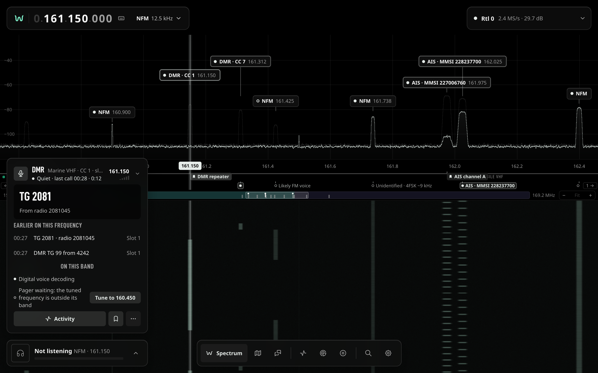
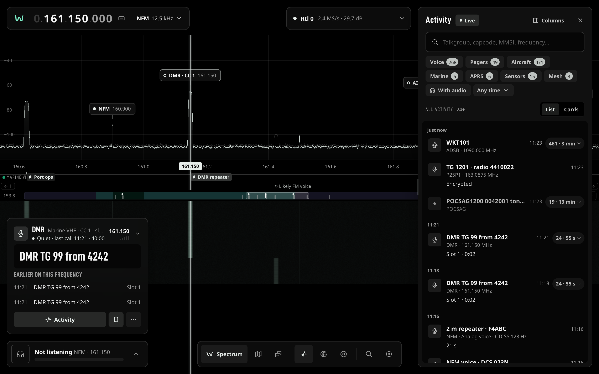
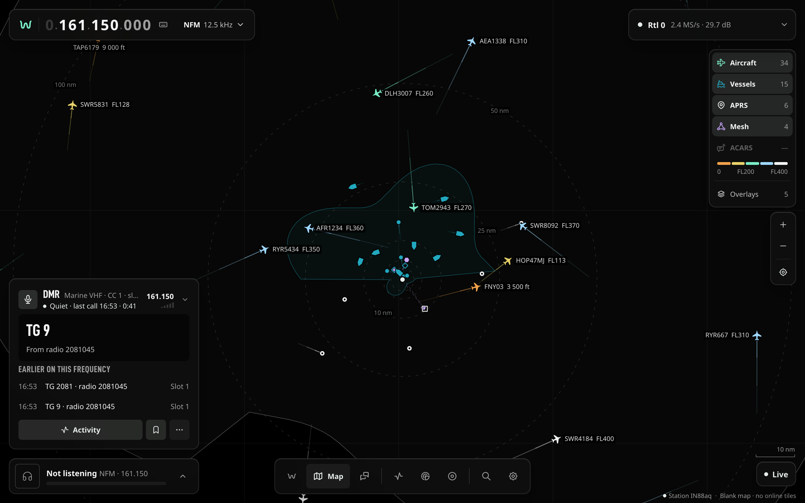

# Using the web app

The web app is WaveKit's main interface. It runs in any recent browser, on a desktop or a phone,
and talks to the core over its REST API and WebSocket. The code lives in [`web/`](../web/).

## Open it

- **Without a radio:** `pnpm --filter @wavekit/web mock`, then `pnpm --filter @wavekit/web dev`,
  and open <http://localhost:5173>. The mock plays a station with aircraft, ships, pagers, DMR and
  more ([`web/mock/README.md`](../web/mock/README.md)).
- **With your core:** `WAVEKIT_WEB_API=http://<core-host>:9000 pnpm --filter @wavekit/web dev`.
  When the core runs on another machine, set its `liveDemod.publicOrigin`
  (`WAVEKIT_LIVE_DEMOD__PUBLIC_ORIGIN`) so live audio reaches your browser
  ([core reference](CORE-REFERENCE.md)).
- **Protected core:** the first visit shows a **Pair this browser** chip. Pair once, and the
  browser stays signed in. Signed-in devices are listed in the ⌘K palette.

## The screen

The app has three views, picked from the dock at the bottom: **Spectrum**, **Map** and
**Messages**. Drawers open on the right on top of the view: **Activity**, **Scanner**,
**Recordings** and **Settings**. On a phone, the ⌘K palette (the search button) is the way around.

### Spectrum and waterfall

- Drag the spectrum to tune, or click a peak. Drag past the edge of the capture to retune the
  receiver.
- The band ruler under the spectrum shows the band plan and your saved frequencies. Zoom with its
  `−` `+` buttons.
- Labels on the peaks say what WaveKit identified there (`DMR · CC 1`, `AIS · MMSI …`). Settings ›
  Spectrum › Signal labels chooses how many you see.
- Labels and tags always sit at their own frequency inside the visible span. After a retune or a
  sample-rate change, the labels from the previous window disappear at once; only signals heard in
  the new window are labelled.
- Right-click a signal for its menu, which includes **Decode as…** to try a decoder on it.
- Signals close together share one tag with a count (`DMR · CC 1 +2`). Click it for a list of the
  grouped signals; each row has a **Tune** button.
- When found signals lie outside the visible span, a marker at that edge shows how many, with an
  arrow (its tooltip reads `3 signals outside view →`). Clicking it asks "Tune to … MHz?" for the
  nearest of them first; it never retunes on its own.
- Click a tag to see what it is: the protocol (`DMR` once verified; before that `Likely DMR`,
  `Maybe DMR` or `Heard`), a muted `likely <kind>` hint (for example `likely ISM device`) when nothing has been verified
  yet, the next step from the decoders that cover its frequency (for example "Listen to check",
  "Widen the capture so … fits" or "No decoder covers this frequency; run identify") and a
  **Tune** button. Clicking a tag never tunes by itself. The same `likely …` hint and next step
  appear beside unverified rows in the Scanner lists.

### The tuned card

The card on the left follows the frequency you are tuned to: what is heard there, the last
transmissions, decoded content, and the actions (Activity, save, Identify, Open message).

Under the last transmissions, **On this band** lists the decoders whose band holds the tuned
frequency (within 200 kHz of one of their frequencies or of the span between them, or inside
their band), the ones listening first. Each line is the core's one-sentence verdict, for example
"ADS-B decoding" or "ADS-B paused: CPU budget full", with a filled dot for a decoder that runs and
a hollow one for one that does not. A decoder that does not run gets one button for the core's
first suggestion:

| Suggestion                                     | Button                                     | What it does                                                                                                              |
| ---------------------------------------------- | ------------------------------------------ | ------------------------------------------------------------------------------------------------------------------------- |
| Start, restart                                 | Start, Restart                             | Starts or restarts that decoder                                                                                           |
| Raise the CPU budget                           | Raise CPU budget                           | Adds one core to the decoder CPU budget, up to its maximum of 64 (Undo in the toast); Settings › Decoders keeps the value |
| Pause the scanner                              | Stop the scan                              | Ends the scan, which gives the tuner and the decoders back (a paused scan keeps them)                                     |
| Tune to its band                               | Tune to 1090.000                           | Tunes the receiver to the decoder's frequency                                                                             |
| Change the sample rate, check the source       | Raise sample rate, Check the receiver…     | Opens the Receiver, where you set it                                                                                      |
| Turn on, turn off others, install, channelizer | Turn on in Settings, Decoders in Settings… | Opens the decoder's row in Settings                                                                                       |

A decoder set to off in Settings shows "off in Settings" and only links there, whatever its last
verdict said: turning decoders on and off stays in Settings. When the budget is already at its
maximum, the next suggestion's button shows instead of Raise CPU budget; the card reads the budget
again each time it refreshes the verdicts, so a budget lowered elsewhere offers the raise again. The
raise and its Undo each change the budget only if nobody changed it since the card read it (the
core checks this as it saves); otherwise the toast says so, names the value now set, and leaves it. Stop the
scan shows while a scan holds the decoders: moving, holding on a hit, or paused. A verdict this app
does not know shows as plain text without a button. With read-only access the buttons that change
something are disabled; the links still work.

### Listen

The bar under the tuned card plays the demodulated audio in the browser: analog modes with squelch
and tone squelch, and decoded digital voice. **Record** saves a WAV file from the browser.

On NFM with auto squelch, a carrier alone does not open the audio: the core waits for evidence
that someone is talking (voice, or a CTCSS or DCS tone) and the bar says what opened it, for example
**Open on CTCSS**. The `autoSquelch` field of
[`GET /api/live-audio/status`](API.md#get-apilive-audiostatus) reports the gate.

## Drawers

- **Activity:** everything WaveKit heard, newest first. Search by talkgroup, capcode, MMSI, ICAO,
  callsign or frequency, filter by category and time range, show a list or cards, choose columns.
  If the core rate-limits a request, Activity retries by itself up to 3 times, unless the core asks
  for a wait over 10 s. Each wait is the one the core asked for (at least 0.25 s; 0.5, 1, then 2 s
  when it names none) plus up to 20 % random jitter, so a single wait can reach 12 s. If retrying
  stops, Activity shows `rate limited, retry in N s` (or `rate limited, retry later`).
  While the core is still opening its Activity store, the drawer says `Activity is starting…`; if
  an open failed and the core is retrying, it says `Activity store unavailable, retrying`. It checks
  again every 3 s and loads the list by itself once the store opens.
  Repeats fold into one row per thing going on (see [Activity folding](#activity-folding)).
- **Scanner:** watch the band in view or plan a scan, see the signals found, skip the ones you do
  not care about, save presets.
- **Recordings:** recordings kept by the core, to play, search and keep. The footer line sums
  the disk they use: what you kept, digital-voice calls, scanner evidence and named IQ captures
  (each with its limit), then the free space.
- **Settings:** station, receiver, decoders (each one starts **auto**, **always** or **off**), band
  plans, spectrum and waterfall, map, units and time, theme, density and motion. A paused decoder
  says why, for example `Paused · the capture is too narrow here` or `Paused · no channel selected yet`.
  Each decoder lists where it listens and why, for example `162.025 MHz (tuned)`, or
  `(activity)` for a paging or digital-voice channel chosen because it was active.
  **Decoders › Decoder CPU budget** shows the total cores used across sources against the budget,
  with its resolved source (for example `Auto (8 CPUs → 4 cores)` or `configured`). Enter **Auto**
  or a number greater than 0 and up to 64, including fractional cores; press Enter or leave the
  field to save immediately. Invalid values and save errors appear under the row. The control
  is disabled with read-only access or when the core denies settings writes; signing in again
  allows another save attempt. On deployments without settings writes, the row shows the current
  budget and a note to set `decoderPolicy.efficiency.cpuBudgetCores` in YAML config.
  A saved override adds “Saved setting overrides config”. On cores without the budget service,
  the row is disabled and says “Not available”.
  **Receiver › Per-band gain** lists the gain the core sets in each frequency range: scanner hops
  and jobs that tune into a listed band use its gain and give yours back after (also when you
  tune away from a running sweep), so a gain
  that suits one band does not overload the dongle in another (the defaults set 37.2 dB at 868 and
  915 MHz and keep the gain at 2 m, 70 cm and ADS-B). Edit a band's range in MHz and its gain in dB,
  or press **Keep** to leave the gain alone there; **Add band** and the `×` add and remove rows.
  **Save** sends the whole table and **Discard** drops your edits. Fields the core would refuse are
  marked before anything is sent (a range outside 24 to 1900 MHz, an end not above the start,
  ranges that overlap, ends included, a gain outside 0 to 50 dB, more than 32 bands), and the
  core's own message shows under the row if it refuses the save. **Per-band gain for my tuning**
  (off by default) saves at once: on, your own retunes also set the band's gain and give yours
  back outside the bands. See [Per-band gain](API.md#per-band-gain-get-and-put-apituner-band-gain).
- **Receiver** (the island at the top): under Gain, a quiet line says when the core confirms a
  band gain on the tuner, for example `Band gain 37.2 dB · 868 MHz ISM · while the
scanner tunes` (or `· for your tuning` with the switch on). It shows the gain the tuner really
  has (snapped to its gain step) and goes away as soon as you change the gain, the mode or the
  frequency; turning the switch on shows nothing until your next retune. When the scanner sees broadband
  blanking rise at a manual gain, the line `Front end may be overloaded at this gain (49.6 dB,
7.5 % of frames blanked)` suggests a lower gain; it is a hint, not a measurement.

### Activity folding

Activity folds repeats into stacks, so one aircraft, one beacon or one call is one row. A stack
shows its newest decode as it was stored, with only who it is filled in from rows heard before it
(an aircraft's callsign when the newest decode is position only; by time, the latest value wins,
never a row heard after it even when stored earlier); a measurement such as a call's
duration, an altitude, a position or a signal level is always the newest decode's own, so a call
that has just started never shows the previous over's duration. The row also shows the count and
the span (`24 · 1 min`) and expands in place to the earlier rows. Counts are for the loaded list,
never totals: the list footer says `312 events in 41 rows, loaded so far.`, and the header counts
rows (its tooltip says `41 rows in the 312 loaded events`). Folding runs in the browser over the
rows already loaded (at most 5 000), and each live update folds again only the stacks its decodes
touched; with a short folded list, Activity loads up to 10 older pages of 100 by itself to fill the
view.

Each row gets a fold key from its own data: protocol and event kind, the core's entity
(`icao:`, `mmsi:`, `capcode:`, `talkgroup:`, `sensor:`, `callsign:`, `node:`; the title when there
is none), the channel to 1 kHz where an entity is only unique per channel, and, when the row
carries a message, its kind (tone only, numeric, alpha) and its exact text, so two different pages
never fold. Ingestion gaps never fold. Rows of one key are taken in the order they were heard, and
a silence longer than the family's gap between two of them ends a stack (a row stored late never
bridges one):

| Family                        | Gap    | Why                                                                                                                           |
| ----------------------------- | ------ | ----------------------------------------------------------------------------------------------------------------------------- |
| Aircraft (ICAO, registration) | 2 min  | readsb sends 1-30 messages/s; the core stores a position update at most once a minute. Twice that tolerates one missed minute |
| Vessel (MMSI)                 | 10 min | AIS reports every 2 s to 3 min (at anchor); 3 missed anchor reports                                                           |
| Pager (capcode)               | 3 min  | Idle beacons repeat every 30-60 s; 3 × 60 s tolerates two missed beacons                                                      |
| Call (talkgroup and radio)    | 10 s   | Bursts are under 3 s apart; 2 × a 5 s hang time ends the call                                                                 |
| Sensor                        | 5 min  | 433/868 MHz sensors send every 16-60 s; 5 × 60 s                                                                              |
| APRS station (callsign)       | 15 min | Fixed stations beacon every 10 min; plus 50 % jitter                                                                          |
| Mesh node                     | 30 min | Meshtastic sends position every 15 min by default; twice that                                                                 |
| Anything else                 | 2 min  | One exchange on one channel (analog overs are seconds apart)                                                                  |

A talkgroup's calls are one stack per radio. A DMR `call_start` that arrives before its radio is
decoded joins the call that follows it on the same talkgroup and channel (or, with none within the
gap, the call before it) instead of becoming a stack of its own. A capcode is one stack per channel,
except that the same page (same capcode, kind and text) heard within 2 s of one of the stack's
decodes on another channel is a simulcast copy and joins the stack: the row lists the channels it
was heard on (`On 160.450 · 466.075 MHz`), and the detail shows the decode's own Frequency with the
stack's other channels under Also heard on (simulcast). The copies may arrive in either order: a
repeat whose first copy lands on the other channel joins the stack that already heard both channels,
so a beacon repeated on two channels stays one stack however its copies interleave. A channel stays
with the stack only while its copies keep arriving within 2 s of the others: a repeat heard later on
that channel alone is a stack of that channel again. The 2 s is one POCSAG batch at the slowest
rate (544 bits at 512 baud, 1.06 s), the most two decoders' timestamps of one page differ, plus the
network's launch skew between transmitters (under 1 s).

Stacks are ordered by their latest decode. At the top of the list, a stack that hears again moves
to the top and keeps its place in React and stays expanded (its key is kept while it shares a row
with the stack before, so older rows leaving the list or an older page loading do not reset it); while you are
scrolled down or Paused, new decodes wait behind the `N new` pill and nothing moves. The pill counts
rows (stacks), not decodes: one beacon heard five times while you were away is `1 new`, and its
tooltip says how many decodes are waiting. In the list, ↑ / ↓ move the cursor, → expands the stack
under it and ← collapses it (on an earlier row, ← collapses its stack and returns to it); where there
is nothing to expand or collapse, ← / → move between the columns. Reopening the drawer shows the
last list at once (with `Updating…`) while it reloads, also for a rolling range such as **Last hour**
whose start has moved on (rows now before its start are dropped); the fresh rows join the kept ones
when they overlap, else they replace them. Kept rows the store has since pruned, or that the fresh
rows' range no longer holds, are dropped, and loading older rows continues after the oldest kept
row rather than fetching the kept ones again (after a rolling range moved on, with the range it was
loaded for, keeping only rows inside the current one). If the core no longer takes that position
(it expired), loading starts again from the fresh rows and skips the pages of kept rows, at most one
page per 100 kept rows.

Before the first rows arrive, the list shows its shape in placeholder rows (`Loading what was
heard…` after a second). An empty list says which case it is: **Nothing heard yet** with **Find
signals** (opens the Scanner) when nothing narrows it, **Nothing matches yet** with **Clear
filters** and, for a time range, **Any time** when a search or range does, and **Nothing was heard
in this range** for a range that has ended.

An event's detail shows the event exactly as it was stored. Who rows of its stack heard before it
said it is (never a later row; the same rule as the list row), when this decode does not say it (a title, callsign, flight, registration or name), is a
separate **Latest known (from earlier rows)** block, each value with the time of the row that said
it. The detail says **What it is** as a guess from its stack, labelled as one: a tone-only
capcode repeating on a schedule reads `Likely a paging-network idle beacon (no content, repeats
about every 45 s)`; bursts of one talkgroup and radio read `Likely one call: 24 bursts over 55 s`.
A schedule needs at least 3 rows with every interval within 35 % of the median. The detail also
shows how often it was seen, the strength when the decoder sends it, **Open in Scanner** when a
discovery sits within 12.5 kHz, and up to 50 folded rows.

## Map and Messages

The **Map** shows aircraft, vessels, APRS stations and mesh nodes around your station, with their
trails and the station's coverage. **Messages** shows decoded messages as cards; open one to see its
full content or its position on the map.

## Keyboard

| Key                  | Action                            |
| -------------------- | --------------------------------- |
| ⌘K / Ctrl K          | Command palette                   |
| ⌘, / Ctrl ,          | Settings                          |
| `T`                  | Tune to a frequency               |
| `M`                  | Mode                              |
| `Q`                  | Squelch                           |
| `[` `]`              | Step down / up                    |
| `L`                  | Listen                            |
| `B` / `S`            | Saved frequencies / save this one |
| `/`                  | Search Activity                   |
| `G` then `S` `M` `D` | Spectrum, Map, Messages           |
| `G` then `A` `C` `R` | Activity, Scanner, Recordings     |
| `?`                  | All shortcuts                     |
| `Esc`                | Close the top drawer or sheet     |

## Links

The address bar names what is on screen, so a link reopens it: `#/map`, `#/activity/<eventId>`,
`#/scanner/<discoveryId>`, `#/settings/<settingId>`.

## Install it

WaveKit is a PWA: use **Install WaveKit** in the ⌘K palette, or your browser's install button.
Browsers only install from HTTPS or `localhost`.

## For contributors

- Design system and decisions: [`docs/web/DESIGN.md`](web/DESIGN.md), tokens in
  [`docs/web/THEME-TOKENS.md`](web/THEME-TOKENS.md).
- What the web app still needs from the core: [`docs/web/CORE-GAPS.md`](web/CORE-GAPS.md).
- Screenshots on this page and in the README come from `pnpm --filter @wavekit/web docs:shots`
  (the built app against the mock, so the data is the same on every run).

Activity pager details show the full stored message when the list presentation
was clipped. List previews and titles keep their compact limits. Multimon whitespace
markers and their raw control characters become spaces in pager titles and message bodies; other control markers are hidden and whitespace
is collapsed. The raw JSON retains the original payload. Empty function-zero pages
are labelled **tone only** and displayed as compact notices.

The band view labels a decode-anchored 1090 MHz discovery **ADS-B · N aircraft**,
where N counts distinct confirmed ICAOs in the last 60 seconds (up to 4096).
The label sits at its nominal channel, independently of nearby narrow carriers.
Its identification is proven by decodes; API spectrum fields contain unmeasured zero placeholders.
The drawer hides RF measurements and transmission history for anchors. Aircraft counts
update through live discovery events when confirmations expire, without a new decode. See [decode-anchored ADS-B](SCANNER.md#decode-anchored-ads-b).

Digital voice tags distinguish sync hints from decoded identities. DMR sync-only
activity is labelled `DMR?`; its detail summary says DMR-like sync, not decoded,
and may show the most frequent color code as `CC 3 (unverified)`. Repeating
Checked TG/SRC voice with unknown CC uses the tag `DMR` and detail
`DMR voice, TG/SRC verified, CC unknown`; this remains weak evidence.
VC/IDLE/MBCC sync never earns a proven tag or `DMR · CC n` identity. A decoded DMR
identity requires repeated checked content, with checked talkgroup/source voice
link control additionally required inside the tuner-centre DC guard. See
[Digital voice identity checks](SCANNER.md#digital-voice-identity-checks).
