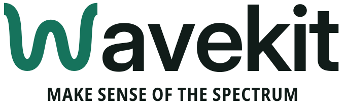
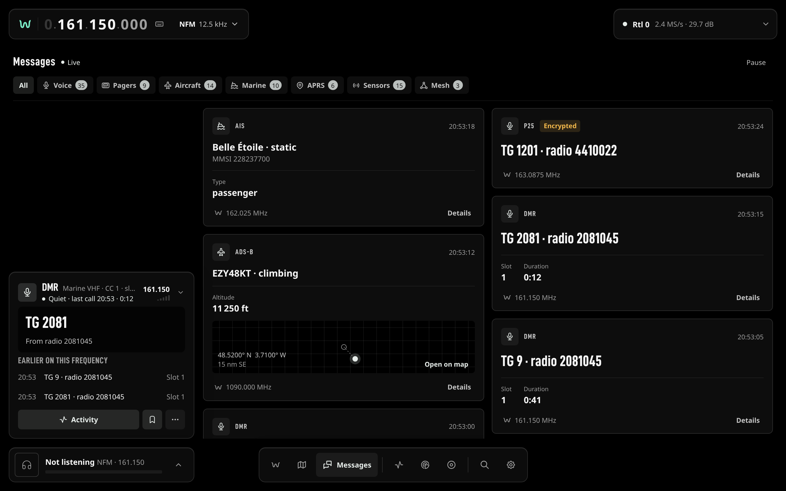
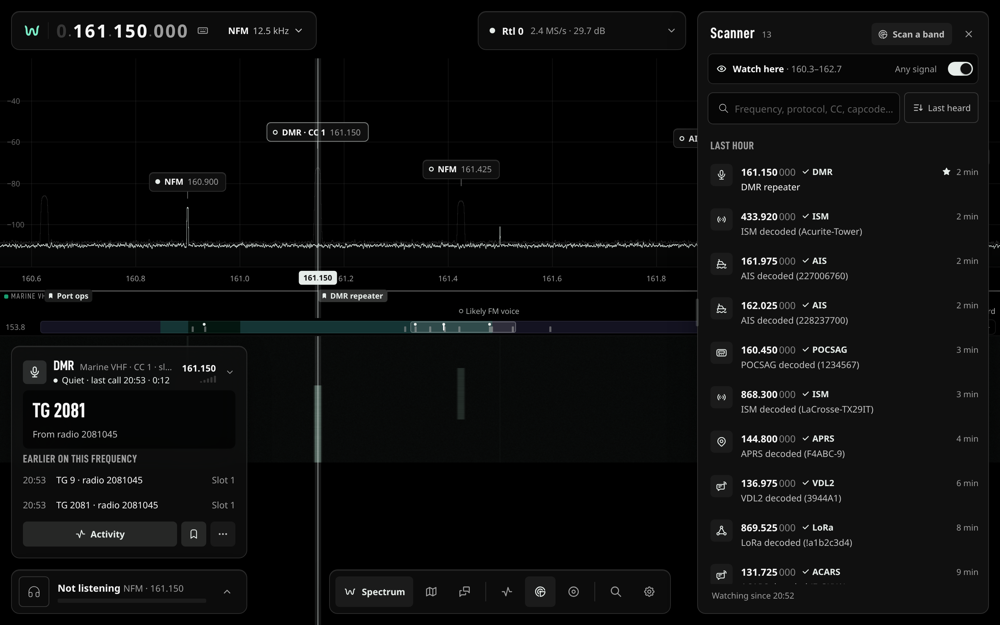

<picture>
	<source media="(prefers-color-scheme: dark)" srcset="packages/brand/logos/wavekit-lockup-on-dark.svg">
	
</picture>

# WaveKit

[](https://github.com/Coriou/WaveKit/actions/workflows/ci.yml)
[](LICENSE)

**See, hear and decode the radio spectrum around you, from your browser.**

WaveKit turns a cheap RTL-SDR dongle into a live window on the airwaves. It decodes aircraft,
ships, pagers, digital voice, APRS, weather sensors and Meshtastic in parallel, and shows all of it
in a fast web app: a live spectrum and waterfall, a map, an activity log and a scanner.

<picture>
	<source media="(prefers-color-scheme: light)" srcset="docs/assets/screenshots/spectrum-light.png">
	
</picture>

## What you get

- **A live spectrum and waterfall.** Drag to tune, click a peak to open it. Signals are labelled
  with what WaveKit identified: `DMR · CC 1`, `AIS · MMSI 228237700`, and so on.
- **Everything decoded at once.** Every decoder whose band falls inside the captured window runs
  in parallel, from one dongle.
- **Listen and record.** Analog demodulation with squelch and tone squelch, decoded digital voice,
  recordings you can play back from the browser.
- **Activity.** A searchable log of everything heard: talkgroups, capcodes, MMSIs, callsigns,
  frequencies.
- **Map.** Aircraft, vessels, APRS stations and mesh nodes around your station, with their trails.
- **Scanner.** Watch a band, find what is active, jump back to it later.
- **Works anywhere.** Light and dark themes, a ⌘K palette, and a layout that works on a phone. You
  can install it as an app (PWA).

| Activity                                                                                              | Map                                                                                               |
| ----------------------------------------------------------------------------------------------------- | ------------------------------------------------------------------------------------------------- |
|  |          |
| **Messages**                                                                                          | **Scanner**                                                                                       |
|                                     |  |

## Quick start

### Try the web app without a radio

The web app ships with a mock server that plays a realistic station, so you can try it in two
minutes. You need Node.js 24 and Corepack.

```bash
corepack enable
pnpm install --frozen-lockfile
pnpm --filter @wavekit/web mock    # terminal 1: mock station on :3101
pnpm --filter @wavekit/web dev     # terminal 2: web app on http://localhost:5173
```

### Run WaveKit with Docker

The core and every decoder run in one image. No hardware is needed for a first run.

```bash
make app-up        # starts the core on http://127.0.0.1:9000
make app-status
make app-logs
```

Then point the web app at it:

```bash
WAVEKIT_WEB_API=http://127.0.0.1:9000 pnpm --filter @wavekit/web dev
```

> The core does not serve the web app itself yet; until it does, run it with the command above.

To use a real receiver, follow [Docker runtime](docs/DOCKER-RUNTIME.md) for a Raspberry Pi or a USB
dongle, and the [fresh-card Pi setup](packages/sdr-host/README.md) to prepare a Pi as an SDR host.

## Hardware

- An **RTL-SDR** dongle (RTL2832U), plugged into a Raspberry Pi on your network or directly into the
  machine running WaveKit.
- Any machine that runs Docker for the core: a Pi 5, a mini PC, a laptop.

## Decoders

| Decoder         | Signals                     | Use                  |
| --------------- | --------------------------- | -------------------- |
| readsb          | ADS-B, 1090 MHz             | Aircraft             |
| AIS-catcher     | AIS, 162 MHz                | Ships                |
| acarsdec        | ACARS, VHF                  | Aircraft data link   |
| dumpvdl2        | VDL Mode 2, 136 MHz         | Aircraft data link   |
| dsd-fme         | DMR, P25, YSF, D-Star, NXDN | Digital voice        |
| multimon-ng     | POCSAG, FLEX, DTMF          | Pagers, tones        |
| direwolf        | APRS, 144 MHz               | Amateur radio        |
| rtl_433         | ISM, 433 / 868 / 915 MHz    | Weather sensors, IoT |
| lora-meshtastic | LoRa, 868 / 915 MHz         | Meshtastic mesh      |

All of them are built into the Docker image. Each one can start automatically when its band is in
view, always, or never (Settings › Decoders).

## How it works

```
RTL-SDR ──IQ──▶ WaveKit core ──▶ decoders (one process each)
 (Pi or USB)        │
                    ├── REST API and WebSocket  ──▶ web app, CLI dashboard, your scripts
                    ├── live audio (HTTP)
                    └── RTL-TCP relay           ──▶ SDR++
```

The core reads one IQ stream, channelises it, and feeds each decoder the slice it needs. Events,
spectrum frames and audio go out over a documented API. See [Architecture](docs/ARCHITECTURE.md).

## Documentation

Start with the [documentation index](docs/README.md). The most useful pages:

- [Using the web app](docs/WEB-APP.md)
- [Docker runtime](docs/DOCKER-RUNTIME.md) and [native development](docs/LOCAL-SETUP.md)
- [API reference](docs/API.md) and [core reference](docs/CORE-REFERENCE.md) (tuner, relay, live audio, configuration)
- [CLI dashboard](docs/CLI.md)
- [Adding a decoder](docs/DECODER-GUIDE.md)

## Contributing

See [CONTRIBUTING.md](CONTRIBUTING.md) for the development setup, the checks to run, and the rule
that keeps this documentation in step with the code.

## License

WaveKit is licensed under AGPL-3.0-or-later (see [LICENSE](LICENSE)). You may use, modify and run it. If you distribute a modified version, or offer it to users over a network, you must publish your changes under the same license.

Using WaveKit through its REST or WebSocket API from a separate program does not place that program under the AGPL. `@wavekit/api-types` (`packages/api-types`) is MIT-licensed so client projects can import the API types freely.

The bundled third-party decoders run as separate processes and keep their own licenses.
